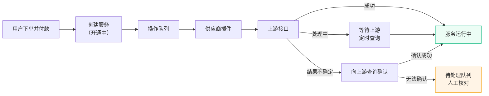

# 供应商转售 {#supplier}

供应商转售用于对接上游供应商，把上游的云服务器等产品作为「模块商品」上架销售。用户在您的站点下单付款后，系统自动使用您在上游的账号余额下单开通，续费、到期暂停、逾期退订也会同步到上游。适合没有自有机器、以转售上游产品为主的服务商，也可以和自营资源同时使用。

::: warning 授权版功能
供应商转售仅授权版可用，需要 Novaix 0.6.0 及以上版本。授权失效后不能新建或修改供应商连接和模块商品，用户也不能再选购；已售出的服务仍可正常续费、操作和人工处理，详见[授权失效后的影响](#license-expired)。
:::

## 工作原理 {#how-it-works}

模块商品与自营的套餐、实例是两条独立的业务线：用户、余额、订单、支付、发票共用，开通过程不经过节点。每个上游通过一个「供应商插件」对接，插件负责把开通、续费、退订等标准操作翻译成上游接口调用。

付款成功后，开通、续费等操作进入队列，由后台按顺序执行，不会阻塞用户的支付流程。同一个服务同一时间只执行一个操作，同一个供应商连接的调用默认串行执行，避免上游购物车、余额等账号级数据互相干扰。

## 开启供应商转售 {#enable}

在管理面板的「系统设置」→「经营模式」中开启「供应商转售」。开启后：

- 管理面板显示「供应商」菜单分组，包含「供应商连接」「模块商品」「服务管理」「待处理」四个页面
- 用户面板显示「我的服务」。同时开启自营资源时，选购页面顶部会出现「云服务器」和「其他服务」的切换

如果您只做转售、没有自有节点，可以同时关闭「自营资源」，后台和用户面板会隐藏节点、实例、套餐等相关菜单。详见[系统设置](./setting#business-mode)。

## 内置供应商插件 {#builtin-plugins}

| 插件 | 对接系统 | 支持的操作 |
|------|---------|-----------|
| 魔方业务系统 | 智简魔方业务系统 V10（魔方云模块，10.4.6 及以上） | 开通、续费、暂停、退订、开关机、重启、重置密码、重装系统、控制台 |
| 魔方财务系统 | 智简魔方财务系统 v3 | 开通、续费、暂停、退订、上游产品提供的模块操作、控制台 |
| WHMCS | WHMCS（经典 API） | 开通、续费、暂停、退订、重置密码、自定义模块操作、控制台 |
| 雨云 | 雨云云服务器（RCS） | 开通、续费、开关机、重启、重置密码、重装系统、控制台、释放 |

所有内置插件都以您在上游的账号余额支付，请确保上游账户已开启 API 并预存足够余额。

::: warning
内置插件依据上游公开的源码和接口文档实现，尚未在真实环境联调。正式销售前，请先用测试账号完成一次完整的开通、续费、暂停和退订流程，确认结果符合预期。
:::

::: details 各插件的注意事项
- **魔方业务系统**：退订通过上游的「停用申请」提交立即停用，由上游每日定时任务执行，执行后上游主机为暂停状态。上游不允许自定义停用原因时，可以在连接中填写停用原因 ID，留空则使用上游第一个原因。上游只接受可用状态主机的停用申请，因此对已暂停的服务退订时，插件会临时解除暂停、提交申请后再恢复暂停。
- **魔方财务系统**：退订提交立即取消请求，由上游定时任务执行。上游的其他配置项和自定义字段在商品中按「配置项 ID → 值」填写。
- **WHMCS**：需要上游为您创建 API 凭据，并提供用于下单的客户 ID。退订方式可选「提交取消申请」或「直接终止」，直接终止需要上游 API 角色允许 `ModuleTerminate`。「控制台单点登录」默认关闭，开启后用户会以上游客户账号的身份登录 WHMCS 客户中心，能看到该账号下的全部服务和余额，仅在上游为您单独开户或可以接受时开启。
- **雨云**：如果雨云账号开启了 API 二次验证，需要先关闭。暂停和恢复以关机、开机代替。退订时，已到期的实例直接释放；未到期的实例在雨云允许退订时提交退订，否则返回失败，进入待处理队列由您人工处理。
:::

如果需要对接其他上游，可以自行开发供应商插件，详见[插件系统](./plugin#supplier)。

## 添加供应商连接 {#connection}

供应商连接保存一个上游账号的接口地址和凭据。同一个插件可以添加多个连接，对应多个上游或同一上游的多个账号。

在管理面板的「供应商」→「供应商连接」页面，点击「新建连接」，先选择供应商插件，再填写插件要求的连接配置（接口地址、账号、密钥等）。连接创建后不能更换插件。

| 字段 | 说明 |
|------|------|
| 名称 | 连接的显示名称，仅后台可见 |
| 状态 | 「正常」可新购和续费；「维护（停止新购）」只停止新购，已售服务照常；「停用」暂停该连接的全部上游调用，相关操作转入人工处理 |
| 余额告警阈值 | 上游余额低于此值时向管理员发送告警，0 表示使用系统设置中的默认阈值 |
| 每分钟调用上限 | 限制该连接每分钟调用上游的次数，0 表示使用默认值 |
| 备注 | 后台备注 |

保存后在连接列表中点击「测试连接」，系统会用填写的凭据调用上游，并显示当前余额。连接配置中的密钥加密存储，编辑时不回显。

## 上架模块商品 {#product}

模块商品对应上游的一组固定配置。在「供应商」→「模块商品」页面点击「添加商品」：

| 分区 | 说明 |
|------|------|
| 基础信息 | 商品名称、分类、地域和描述，展示给用户 |
| 上游配置 | 选择供应商连接，再选择上游商品、系统镜像、上游周期等。下拉选项从上游实时加载，支持搜索和翻页 |
| 展示规格 | CPU、内存、磁盘、带宽、流量，仅用于展示，不影响上游开通的配置 |
| 定价 | 勾选月付、季付、年付并填写售价；参考成本用于毛利统计 |
| 销售设置 | 库存、排序、状态和是否需要实名认证 |
| 下单与操作 | 允许用户下单时填写的字段（如登录密码），以及不对用户开放的操作 |

商品状态有三种：「上架」可新购；「隐藏（仅续费）」不再新购，已售服务可以继续续费；「下架」不可新购。

::: warning
修改商品的上游配置、展示规格、下单字段或当前售价后，用户此前创建但尚未付款的订单会失效，付款时提示「商品配置或价格已调整」，用户需要重新下单。这样可以避免旧订单按旧价格开通新配置。只修改名称、描述、库存、排序不影响已有订单。
:::

## 用户购买与开通 {#purchase}

用户在「我的服务」页面点击「选购」（或在选购页面切换到「其他服务」），选择商品、计费周期并填写下单字段，提交后跳转到订单详情页支付。付款后服务进入「开通中」，上游开通完成后变为「运行中」，并通知用户。

模块商品的订单与实例订单有以下区别：

- **不支持优惠券**：下单和续费都不能使用优惠券
- **不参与代理返佣和分销**：模块商品订单不产生代理佣金，也不走分销扣款
- **用户不能自助申请退款**：退款由管理员在后台操作，详见[退款](#refund)
- **到期时间从开通成功起算**：上游开通耗时不占用用户的服务时长

付款时系统会再次检查商品是否在售、连接是否正常、插件是否启用。如果下单后商品已停售，余额支付会直接提示失败；在线支付的款项会转入用户余额，订单自动取消。

## 用户面板 {#portal}

用户在「我的服务」中管理已购服务：

- 查看 IP、端口、用户名、操作系统等登录信息，登录密码需要点击后才显示
- 执行上游支持的操作，如开关机、重启、重置密码、重装系统
- 打开控制台（上游支持时）
- 续费、开启或关闭自动续费、修改服务名称

用户面板的接口只返回规格、IP、端口、用户名、系统等标准化字段，不包含上游、插件或供应商连接信息。如果您希望用户端不区分自营和转售，可以基于[开放接口](./integration)或自定义[主题](./theme)统一展示。

## 续费、到期与退订 {#lifecycle}

模块服务的到期处理沿用「系统设置」→「实例生命周期」中的宽限期设置：

| 阶段 | 处理 |
|------|------|
| 到期前 3 天 | 向用户发送到期提醒 |
| 到期前 24 小时 | 开启了自动续费且余额充足时，自动扣款并向上游续费；余额不足时通知用户 |
| 到期后（暂停宽限期后） | 向上游提交暂停，服务变为「已暂停」 |
| 到期后（删除宽限期后） | 向上游提交退订，退订完成后服务变为「已终止」 |

几点说明：

- **续费价格**：按购买时的价格续费，修改商品售价不影响已售服务
- **续费成功的判断**：只有上游确认续费成功后才延长本地到期时间。上游续费失败时，订单标记为失败并进入待处理队列，您可以重试或为用户退款
- **待付款的续费单**：自动续费成功后，该服务未付款的续费订单会自动取消，避免重复续费
- **退订需要时间**：部分上游的退订由其每日定时任务执行，服务会在「退订中」状态停留一段时间，属于正常现象

## 结果未知与待处理 {#operations}

上游接口超时、连接中断或返回无法识别的结果时，系统不会直接判定失败，也不会盲目重新提交（否则可能在上游重复下单扣费）。操作会先标记为「结果未知」，由系统向上游查询确认：

- 确认已执行：按成功处理
- 确认未执行：沿用同一个幂等键重新提交
- 长时间无法确认：转入「待人工处理」，并通知管理员

「供应商」→「待处理」页面汇总所有需要关注的操作，侧边栏菜单会显示待处理数量。操作状态说明：

| 状态 | 说明 |
|------|------|
| 排队 | 等待执行 |
| 执行中 | 正在调用上游 |
| 等待上游 | 上游已受理，正在处理，系统会定时查询结果 |
| 结果未知 | 上游是否执行尚未确认，系统正在查询 |
| 待人工处理 | 系统无法自动确认，需要您到上游核对 |
| 失败 | 上游明确返回失败，如余额不足、库存不足 |
| 成功 / 已取消 | 已结束 |

点击操作的「处理」按钮，在上游核对后选择：

| 处理方式 | 适用情况 |
|----------|---------|
| 重试 | 确认上游未执行，或上游余额已充值。失败的操作会重新调用上游；结果未知的操作会先向上游查询，确认未执行后才重新提交 |
| 标记成功 | 已在上游确认执行成功。开通操作需要补录上游资源 ID，以便后续续费、退订和同步 |
| 标记失败 | 已在上游确认未执行，按失败处理。开通或续费失败的订单可以在「订单管理」中退款 |

点击操作可以查看执行日志，日志记录了每次调用上游的请求和响应，密钥、密码、令牌等敏感字段会自动打码。

::: tip
上游余额不足是最常见的开通失败原因。建议为每个连接设置余额告警阈值，余额偏低时及时充值。
:::

## 同步与对账 {#sync}

系统按「系统设置」→「经营模式」中的「同步间隔」定期从上游同步服务的状态、到期时间、IP 等信息，并每小时检查一次各连接的上游余额。

同步发现本地与上游不一致时（如上游已终止但本地仍在运行、上游到期时间早于本地），会在待处理队列中生成一条「对账差异」记录，不会自动修改本地状态。您核对后可以在服务详情中执行相应操作，再将差异标记为已处理。

在「服务管理」的服务详情中，您还可以手动同步、暂停、恢复、退订服务，或执行与用户相同的操作。

## 退款 {#refund}

模块商品订单只能由管理员退款。在「订单管理」的订单详情或服务详情中点击「退款」，选择退款方式：

| 方式 | 说明 |
|------|------|
| 仅退款 | 立即将订单金额退回用户余额，上游服务保持不变，可以稍后在服务详情中手动退订 |
| 退款并退订 | 先向上游提交退订，上游确认退订成功后再自动退回余额 |

开通失败的订单选择「仅退款」即可，服务会被取消，库存自动回补。

::: warning
「仅退款」只退回金额，不改变服务状态。如果服务已经开通，退款后服务仍在运行，请在服务详情中退订，否则用户可以继续使用，到期时还会按自动续费设置继续扣费。
:::

## 授权失效后的影响 {#license-expired}

授权失效后，供应商转售只停止新业务，已售出的服务不受影响：

| 功能 | 授权失效后 |
|------|-----------|
| 新建或修改供应商连接、模块商品 | 不可用 |
| 用户选购新服务 | 不可用，用户面板隐藏选购入口 |
| 已售服务的续费、自动续费、到期处理 | 正常 |
| 用户在「我的服务」中查看、操作、续费 | 正常 |
| 后台「服务管理」「待处理」和退款 | 正常 |

续费授权后，新购功能立即恢复。
